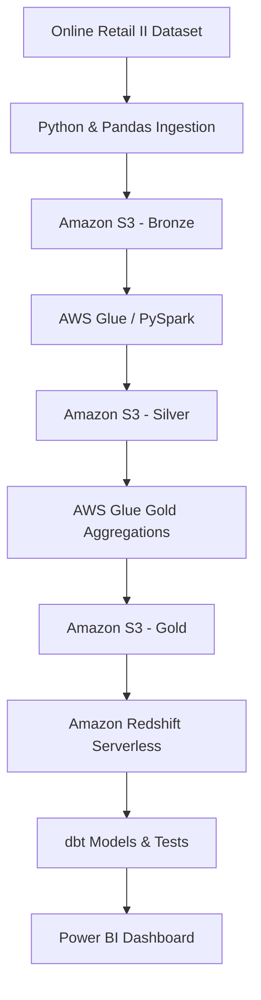
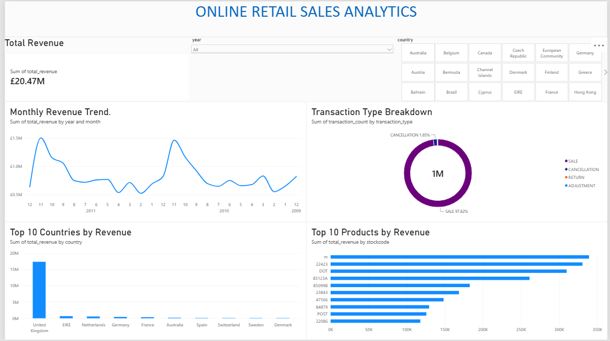

# Cloud-Based Data Lakehouse for Sales & Customer Analytics

An end-to-end data engineering project that transforms the **Online Retail II** dataset into business-ready analytics using AWS, PySpark, dbt, and Power BI.

## Architecture



## Engineering Workflow

- **Ingestion:** Loaded and inspected the retail dataset using Python and Pandas, with Parquet-based data preparation.
- **Bronze:** Stored ingested data in Amazon S3.
- **Silver:** Used AWS Glue and PySpark to clean nulls, analyze duplicates, classify transactions, and validate data quality.
- **Gold:** Built five analytical datasets through dedicated AWS Glue jobs.
- **Warehouse:** Restored the five Gold tables in Amazon Redshift Serverless.
- **Analytics Engineering:** Developed five dbt models and validated them with nine passing data tests.
- **Visualization:** Connected Power BI to the analytics layer to explore sales, products, countries, and transaction types.

## Data Volume & Quality Metrics

The project processes the **UCI Online Retail II** dataset through ingestion, data cleaning, analytical aggregation, and warehouse modeling.

| Metric | Result |
|---|---:|
| Original source records | 1,067,371 |
| Records after local cleaning | 1,033,036 |
| Records removed during cleaning | 34,335 |
| Retained records | 96.78% |
| Records removed | 3.22% |
| Gold analytical datasets | 5 |
| dbt analytical models | 5 |
| Passing dbt data tests | 9 |
| dbt warnings | 0 |
| dbt errors | 0 |

### Data Quality Improvements

The transformation workflow included:

- Profiling missing values, including **243,007 missing customer IDs** and **4,382 missing descriptions** in the original dataset.
- Investigating duplicate invoice and stock-code combinations.
- Cleaning required fields and deduplicating records according to the implemented rules.
- Investigating negative prices and classifying sales, returns, cancellations, and adjustments.
- Validating transformed data before downstream analytical use.

**Retention rate:** 96.78% of the original records remained after local cleaning. The 34,335 removed records reflect the combined effect of the implemented cleaning and deduplication steps; they should not be interpreted as 34,335 duplicates.

### Cloud Data Pipeline

The processed data flows through three lakehouse layers:

- **Bronze:** Raw ingested data stored in Amazon S3.
- **Silver:** Cleaned and standardized data processed using AWS Glue and PySpark.
- **Gold:** Five business-oriented analytical datasets stored in Amazon S3 and loaded into Amazon Redshift Serverless.

The Gold layer supports monthly sales, customer, product, country, and transaction-type analysis.

### dbt Validation

The five dbt models were tested successfully against the Redshift analytics layer.

| Test result | Count |
|---|---:|
| Passed | 9 |
| Warnings | 0 |
| Errors | 0 |

These results represent the successful dbt test run, not a claim that every possible data-quality issue in the source dataset has been eliminated.

## Gold Analytics

| Dataset | Business purpose |
|---|---|
| `monthly_sales` | Monthly revenue, transaction counts, and quantities |
| `customer_analytics` | Customer purchasing analysis |
| `product_analytics` | Product performance analysis |
| `country_analytics` | Geographic sales performance |
| `transaction_summary` | Transaction-type breakdown |

## dbt Models

Five models expose the Gold datasets as analytical views in Redshift:

- `monthly_sales_summary`
- `customer_analytics_summary`
- `product_analytics_summary`
- `country_analytics_summary`
- `transaction_overview`

**Validation result:** 9 passing dbt tests, with no warnings or errors in the successful run.


## Business Insights & Dashboard Metrics

The Power BI dashboard summarizes sales performance and transaction patterns from the processed Online Retail II dataset.

### Key Dashboard Metrics

| KPI | Dashboard result |
|---|---:|
| Total revenue | Approximately 20.47 million |
| Transaction count represented | Approximately 1 million |
| Sales share of transactions | 97.82% |
| Cancellation share of transactions | 1.85% |
| Analytical Gold datasets | 5 |
| dbt models | 5 |
| Passing dbt tests | 9 |

*Revenue and transaction values are rounded as displayed in Power BI. Transaction percentages reflect the current report's transaction-type breakdown.*

### Business Analysis

- **Revenue performance:** The monthly revenue visual supports analysis of sales performance across reporting periods.
- **Transaction composition:** Sales account for 97.82% of the transaction count shown, while cancellations account for 1.85%; returns and adjustments make up the remaining categories.
- **Product performance:** The dashboard compares products by revenue to help identify products contributing most to sales.
- **Geographic analysis:** Country filters support exploration of sales data across different markets. Country revenue rankings should be interpreted only after verifying the chart aggregation.
- **Interactive exploration:** Year and country slicers allow users to filter the dashboard and investigate different reporting periods and markets.

### Business Value

The project converts more than one million source records into curated analytical datasets and an interactive reporting layer. It demonstrates how cloud data engineering and analytics engineering can make retail data more accessible for sales monitoring, product analysis, geographic comparisons, and transaction analysis.


## Power BI Dashboard



The report includes:

- Total revenue KPI
- Monthly revenue trend
- Top 10 products
- Top 10 countries
- Transaction-type distribution
- Year and country slicers

**Report:** [`Online_Retail_Sales_Analytics.pbix`](powerbi/Online_Retail_Sales_Analytics.pbix)

## Technology Stack

**Python · Pandas · PySpark · SQL · Amazon S3 · AWS Glue · Amazon Redshift Serverless · dbt · Power BI · Git**

## Repository Structure

```text
.
├── dbt_project/
│   └── retail_analytics/
│       ├── models/
│       │   ├── marts/
│       │   ├── schema.yml
│       │   └── sources.yml
│       └── dbt_project.yml
├── powerbi/
│   └── Online_Retail_Sales_Analytics.pbix
├── src/
│   ├── ingestion/
│   └── spark/
└── .gitignore
```

## Future Improvements

- Automate pipeline scheduling and execution.
- Add monitoring, logging, and failure notifications.
- Explore incremental processing for larger datasets.

## Key Learnings

Built practical experience in cloud data lakehouse architecture, distributed data transformations, data quality validation, warehouse modeling, and BI integration.